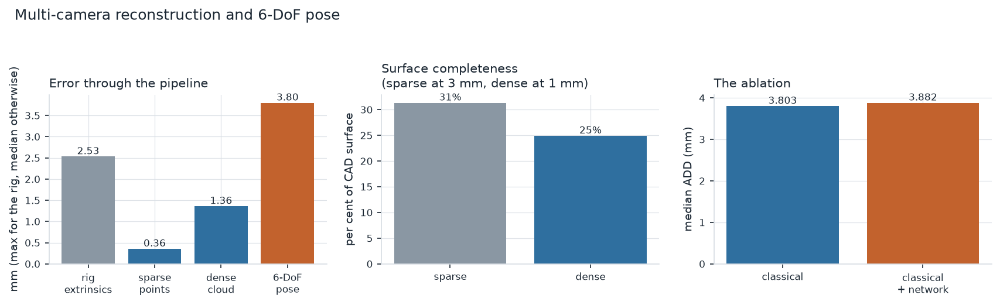
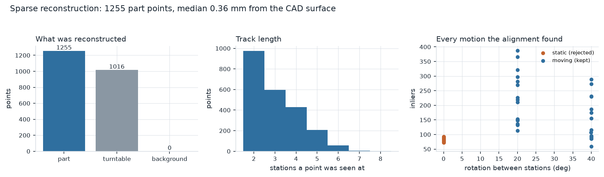
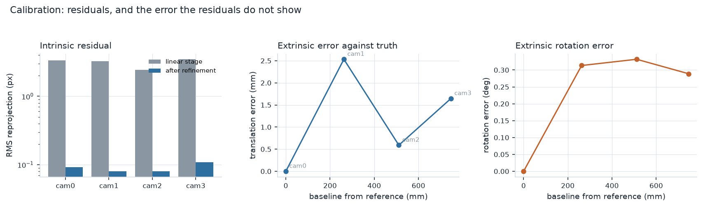
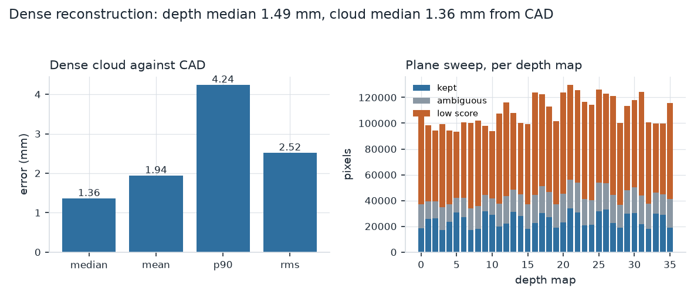
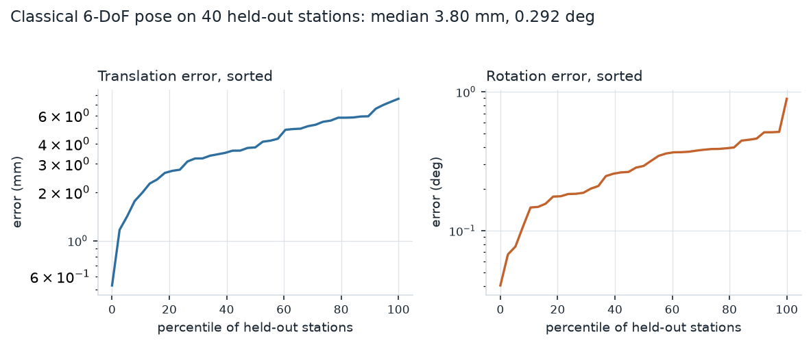
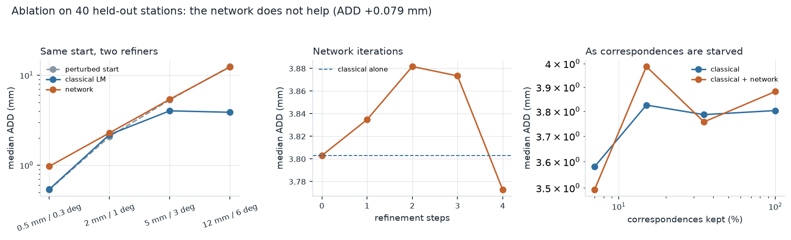

# cv-multicam-3d-reconstruction

> ### Clean-room reimplementation
> This repository is an **independent reimplementation of a problem class**, built from
> scratch on personal time using public and synthetic data and open-source libraries. It
> is **not** derived from and contains no material belonging to any employer or client:
> no employer source code, schematics, calibration data, client data or internal
> documentation. It exists to demonstrate the architecture and engineering approach only.

A calibrated four-camera rig that reconstructs a machined part and finds its
6-DoF pose. Zhang calibration and a rig extrinsic bundle adjustment written from
the equations, multi-view triangulation, a sparse bundle adjuster with a Schur
complement over the landmarks, plane-sweep multi-view stereo, Open3D fusion and
meshing, generalised-camera PnP across the whole rig, and a learned
render-and-compare pose refiner that is ablated against the classical one.

**There is no hardware behind this.** Every image is rendered by a software
rasteriser written for the purpose, from a seed, in about twenty minutes. That
is a real limitation and it is the first entry in
[docs/limitations.md](docs/limitations.md). It is also what makes the ground
truth exact, which is the only reason a calibration can be scored against the
rig it was trying to recover rather than merely against its own residual.

<!-- table:headline -->
The rig calibrates to **0.151 px** of reprojection residual and to within **2.53 mm** of its true geometry on a 747 mm baseline. The part reconstructs to a median of **0.36 mm** from its CAD surface. 6-DoF pose on held-out stations is **3.80 mm** and **0.292 deg** at the median.
<!-- /table:headline -->

### What it looks like

| | |
| --- | --- |
|  | **Error through the pipeline, and what the ablation decided.** Left: the error at each stage, from the rig's extrinsics through the sparse and dense reconstructions to the final pose. Middle: how much of the part's surface each stage actually covers, which is the number that accuracy alone hides. Right: the ablation the whole repository is built around. |
|  | **The part is whatever moves.** Right-hand panel: every rigid motion the cross-station alignment found. The orange cluster at zero rotation is the room, and it is discarded however large it is. With this lens the moving group is the larger one on 31 of 34 edges, so a single RANSAC would mostly get away with it; with the 58-degree lens tried first it was outnumbered twenty to one and the pipeline reconstructed the room. Which group is larger is a property of the lens, not of the algorithm, which is the reason not to select by size. |

---

## What is here

| | |
| --- | --- |
| **Rig** | Four cameras on a 76-degree arc, 0.6 m from a turntable, 32-degree lens, 800 x 600. Each has its own focal length, principal point and radial-tangential distortion; the mounts are perturbed from nominal, which is what the extrinsic calibration has to find |
| **Calibration** | ChArUco detection, normalised-DLT homographies, Zhang's closed form for the absolute conic, then a joint Levenberg-Marquardt over nine intrinsics and every board pose. Rig extrinsics initialised over a maximum-weight spanning tree of the camera co-observation graph, then bundle adjusted. Cross-checked against `cv2.calibrateCamera` on identical detections |
| **Front end** | SIFT with the RootSIFT normalisation, ratio test, mutual consistency, and an epipolar gate that uses the calibrated rig to throw out matches no geometry can explain |
| **Sparse reconstruction** | Per-station multi-view triangulation, cross-station alignment by **multi-motion RANSAC** that keeps the group which moves and discards the static background however large it is, global track building, then bundle adjustment with a Schur complement over the points and a Huber kernel |
| **Dense** | Plane-sweep MVS bounded by the sparse cloud's own volume, ZNCC by box filters, sub-pixel parabola in inverse depth, N-view cross check, Open3D voxel fusion, normal orientation from the viewpoints, screened Poisson meshing with density trimming |
| **Pose** | Appearance model built from the reconstruction and filtered to the CAD surface; generalised-camera PnP under RANSAC over all four cameras at once; Levenberg-Marquardt refinement with analytic Jacobians and a first-order covariance |
| **Learned refiner** | A 0.6 M-parameter render-and-compare CNN over per-camera crops, predicting a twist applied with the same retraction the classical refiner uses. It is given the CAD model's *geometry* and never its appearance |
| **Reference** | COLMAP, through `pycolmap`, on identical images. It shares no code with any of the above |
| **Evaluation** | Reprojection residuals, point-to-surface distance to CAD, completeness, chamfer, ADD and ADD-S with recall at several thresholds, and per-class labelling so the fixture is not scored as the part |
| **Simulator** | A z-buffered rasteriser with near-plane clipping, perspective-correct interpolation and physically correct lens distortion, plus the rig, the scene and the capture planner |
| **Tests** | 135, including every Jacobian against finite differences, the renderer against the projection equations, the bundle adjuster against a known answer, and a firewall test that fails if any pipeline module so much as names a ground-truth accessor |

---

## Run it

```bash
./scripts/run_demo.sh
```

One command on a clean machine. It builds a virtual environment if there is not
one, renders a miniature capture, calibrates the rig from it, reconstructs the
part, estimates 6-DoF pose on held-out stations, and checks every number against
the ground truth it generated. About four minutes. Nothing is downloaded except
Python packages.

`docker compose -f docker/docker-compose.yml run --rm multicam` does the same in
a container.

```bash
make check                 # lint plus the full test suite, exactly what CI runs
make data                  # render the full capture, about 20 minutes
make experiments           # every number below, about 40 minutes after that
make plots tables docs-check
```

**The demo's numbers are worse than the ones below, and deliberately so.** Its
capture is a tenth the size, which calibrates coarsely — about 13 mm of rig
extrinsic error against 2 mm here — and that error passes straight through to
the pose. `make experiments` is what reproduces this page.

---

## Results

Full tables, every metric, every setting: **[docs/results.md](docs/results.md)**.

### Calibration

Per-camera intrinsics from that camera's own board sweep; rig extrinsics from 26
shared stations. The residual is what you would have on real hardware. The error
against truth is what you would not, and the gap between them is the point: a
calibration can have a beautiful residual and be wrong.

<!-- table:calibration -->
| camera | views | intrinsic RMS (px) | fx error (px) | cx error (px) | cy error (px) | baseline (mm) | extrinsic error (mm) | extrinsic error (deg) |
| --- | ---: | ---: | ---: | ---: | ---: | ---: | ---: | ---: |
| `cam0` | 22 | 0.0924 | -0.11 | +1.73 | +7.84 | 0.0 | 0.00 | 0.000 |
| `cam1` | 22 | 0.0802 | -2.32 | +5.89 | +3.40 | 262.7 | 2.53 | 0.313 |
| `cam2` | 22 | 0.0805 | +5.58 | +3.90 | +4.88 | 511.3 | 0.59 | 0.332 |
| `cam3` | 22 | 0.1090 | -0.71 | -1.24 | +3.38 | 746.9 | 1.64 | 0.289 |
| **rig** | 26 stations | **0.1507** | | | | | **2.53 max** | **0.332 max** |
<!-- /table:calibration -->



### Reconstruction

Against the CAD model, in the ground-truth frame, with **no fitting at all** —
the bundle adjustment holds the reference station fixed, so the reconstruction
frame is the rig frame at station 0 by construction and ground truth gives the
transform in closed form. ICP is run afterwards only as a diagnostic, and how
far it moves is reported in [docs/results.md](docs/results.md).

<!-- table:reconstruction -->
| stage | points on the part | median (mm) | mean (mm) | 90th pct (mm) | RMS (mm) | completeness |
| --- | ---: | ---: | ---: | ---: | ---: | ---: |
| sparse | 1255 | **0.356** | 0.560 | 1.157 | 0.801 | 31.3% at 3 mm |
| dense | 53018 | **1.361** | 1.942 | 4.241 | 2.518 | 24.9% at 1 mm |
<!-- /table:reconstruction -->



### 6-DoF pose

Held-out stations, arbitrary orientations drawn from the full rotation group,
against an appearance model built from the turntable scan.

<!-- table:pose -->
| metric | median | mean | 90th percentile |
| --- | ---: | ---: | ---: |
| translation (mm) | **3.800** | 4.130 | 6.066 |
| rotation (deg) | **0.2924** | 0.3053 | 0.4704 |
| ADD (mm) | **3.803** | 4.138 | 6.060 |
| ADD-S (mm) | **3.124** | 3.089 | 4.305 |

| recall | ADD | ADD-S |
| --- | ---: | ---: |
| within 2% of diameter (3.7 mm) | 45.0% | 67.5% |
| within 5% of diameter (9.4 mm) | 97.5% | 97.5% |
| within 10% of diameter (18.7 mm) | 97.5% | 97.5% |
| within 1 mm | 2.5% | -- |

40 stations, 39 solved, 1 refused.
<!-- /table:pose -->



---

## The ablation

The brief this was built to asks for one thing above the rest: does the learned
refiner earn its place, and if it does not, say so.

> ### It does not. The network does not ship.
>
> On the held-out stations it makes the pose **2.1 per cent worse** than the
> classical estimate it was given, and started from the same deliberately
> perturbed pose it loses to a six-parameter Levenberg-Marquardt in every
> magnitude band — badly, at the far end: from 12 mm out, the classical refiner
> recovers to 3.9 mm and the network to 12.4 mm, which is to say it barely moves
> the pose at all. More refinement iterations do not help.
>
> This is not a tuning failure that one more afternoon would fix, and the
> evidence for that is in [analysis/](analysis/README.md#getting-the-pose-refiner-to-learn-anything-at-all).
> The network is capable of the task — it drives the loss from 3.72 mm to
> 0.65 mm when asked to overfit sixteen samples — and three separate
> parameterisation and optimisation bugs were found and fixed on the way here.
> What it could not do is *generalise*: after 4600 steps it is 1.2 per cent
> better than predicting nothing, improving monotonically but hopelessly slowly.
>
> The honest diagnosis is that a hundred distinct training scenes is not enough
> to learn to segment a machined part from a turntable of much the same texture
> in a 96-pixel greyscale crop. The classical refiner does not have to learn
> that, because it is handed correspondences.

### Does it ship?

<!-- table:ablation -->
| configuration | median ADD (mm) | median translation (mm) | median rotation (deg) | recall at 2% of diameter |
| --- | ---: | ---: | ---: | ---: |
| classical alone | 3.803 | 3.800 | 0.2924 | 45.0% |
| classical + network | 3.882 | 3.855 | 0.3436 | 47.5% |

The network **does not improve** ADD; it is 0.079 mm worse, at 145 ms per station on cuda.
<!-- /table:ablation -->

### The same question, controlled

Comparing a classical estimate against a refined classical estimate cannot
separate "the network is a better refiner" from "the classical estimate was
already at the noise floor and there was nothing left to correct". So both
refiners are started from the **same** deliberately perturbed pose, across four
magnitude bands.

<!-- table:head_to_head -->
| perturbation applied | start | classical LM | network | better |
| --- | ---: | ---: | ---: | --- |
| 0.5 mm / 0.3 deg | 0.533 | **0.539** | 0.971 | classical |
| 2 mm / 1 deg | 2.084 | **2.190** | 2.285 | classical |
| 5 mm / 3 deg | 5.331 | **4.021** | 5.400 | classical |
| 12 mm / 6 deg | 12.495 | **3.872** | 12.368 | classical |

Median ADD in mm, same perturbed starting pose for both refiners.
<!-- /table:head_to_head -->



The remaining two experiments — how the result moves with the number of
refinement iterations, and what happens as the classical stage is starved of
correspondences — are in [docs/results.md](docs/results.md).

---

## COLMAP, as an independent reference

COLMAP is the reference implementation for this problem and shares no code with
anything in `src/multicam/reconstruction`. It was run on identical images,
through `pycolmap`.

The comparison is **not symmetric**, and the report says so. COLMAP solves for
every camera pose from scratch, which is a strictly harder problem than ours —
we are handed the calibrated rig — and it recovers geometry only up to a
similarity, so its result has to be scaled before it can be compared to a metric
one.

It is also the experiment that most sharply justifies one of the design
decisions here, and not in the direction expected when it was set up.

<!-- table:colmap -->
| | points on the part | median to CAD (mm) | RMS (mm) | completeness at 3 mm |
| --- | ---: | ---: | ---: | ---: |
| ours | 1255 | 0.356 | 0.801 | 31.3% |
| COLMAP | 0 | -- | -- | 0.0% |

COLMAP registered 15 of 72 images into 3 model(s), with a mean reprojection error of 0.522 px.

**COLMAP did not recover the part from this sequence.** It registered a minority of the images, split them across several models, placed none of its points within 6 mm of the part's CAD surface, and its camera centres disagree with ours by a median of **552 mm** after the best similarity alignment. The spread of each camera's recovered centre across the stations is **197 mm**, against **601 mm** in the object frame the part is actually rigid in.

This is a structural result, not a defect in COLMAP and not a tuning failure. Structure from motion assumes **one** rigid scene; a turntable sequence contains two irreconcilable ones -- a room that does not move and a part that does -- and nothing in the algorithm can prefer one over the other. The instability is the signature: two runs with identical settings registered 50 and 15 of the 72 images, which is what no stable solution looks like.

_This record predates the fixed seed, so the exact registration count is one draw from the spread described above rather than a reproducible figure. `scripts/colmap_baseline.py` now seeds the mapper._

It is also the clearest evidence available that the multi-motion fit in `multicam.reconstruction.align` is necessary rather than ornamental: given the same images, the thing it exists to do is the thing a mature, heavily-tested reference implementation cannot do at all.
<!-- /table:colmap -->

---

## How it works

**[docs/design.md](docs/design.md)** is the architecture: the frame conventions
and the bug they prevent, why the optimiser works on a manifold and what broke
before it did, the Schur complement, why multi-motion alignment is necessary
rather than clever, and what the learned refiner is and is not allowed to see.

**[docs/calibration.md](docs/calibration.md)** is the calibration in detail.

A few things worth pulling out here, because they are the ones that cost real
time:

- **The optimiser parameterised poses by their own logarithm and stepped with
  `x + dx`.** That is wrong by the SE(3) right Jacobian, which is near the
  identity only for small poses. The symptom was not a crash: it was a solver
  that took one step, damped itself to a halt, reported "converged", and left
  intrinsics 36 px out in focal length.
- **The renderer applied lens distortion backwards.** A render warped the wrong
  way still looks like a plausible lens and still calibrates to a self-consistent
  model. Only a comparison against the projection equations shows it up; it put
  2 px of systematic error into every detected corner.
- **The dense stage's ambiguity test rejected 99.98 per cent of pixels**, because
  it compared the winning depth hypothesis against its own immediate neighbours
  in a cost volume that is smooth by construction.
- **The part had an accidental *appearance* symmetry** — not a geometric one —
  from the texture projection, which made the pose estimator land on the wrong
  limb on six of thirty-nine frames at exactly 90 degrees, each with a healthy
  inlier count and a 0.4 px residual. [Section 3a of the
  limitations](docs/limitations.md#3a-one-near-symmetry-was-an-artefact-and-it-cost-six-frames).

---

## Limitations

**[docs/limitations.md](docs/limitations.md)**, in full and in its own document.
The short version:

1. It is all synthetic, and the surface texture is the most flattering
   assumption in it. A real machined part is often shiny and nearly featureless.
2. The synchronised capture code has never been run, and everything here assumes
   the four exposures are the same instant.
3. The part is only weakly asymmetric, so ADD and ADD-S are both reported
   everywhere.
4. The turntable sees the part from one side, which caps completeness and means
   the Poisson mesh invents the underside.
5. The evaluation uses ground-truth segmentation to separate the part from the
   fixture it is bolted to, deliberately, labelled, and confined to
   `multicam.evaluation` by a test.
6. One seed, one rig, one part. The numbers have no error bars.

---

## Repository layout

```
src/multicam/
  geometry/        SO(3), SE(3), the pinhole-plus-radtan camera, triangulation
  sim/             meshes, procedural textures, the rasteriser, the rig, capture planning
  calibration/     ChArUco target, per-camera intrinsics, rig extrinsics
  reconstruction/  features, stations, multi-motion alignment, bundle adjustment
  fusion/          plane-sweep MVS, Open3D fusion and meshing
  pose/            generalised PnP, the classical refiner, the learned refiner
  evaluation/      pose and surface metrics, CAD registration, point labelling
  io/              the capture layout, the COLMAP bridge
  optim.py         manifold Levenberg-Marquardt with a robust kernel
capture/           synchronised capture for real hardware; never run, and says so
scripts/           one per stage, plus the demo, the plots and the table generator
tests/             131 tests
docs/              design, calibration, results, limitations
data/              rendered captures and DATASET_CARD.md; nothing committed
```

---

## Licence

MIT, [LICENSE](LICENSE). Everything in this repository — the code, the rendered
images, the object geometry, the textures — was generated by it. No third-party
dataset is downloaded, used or redistributed; see
[data/DATASET_CARD.md](data/DATASET_CARD.md).
